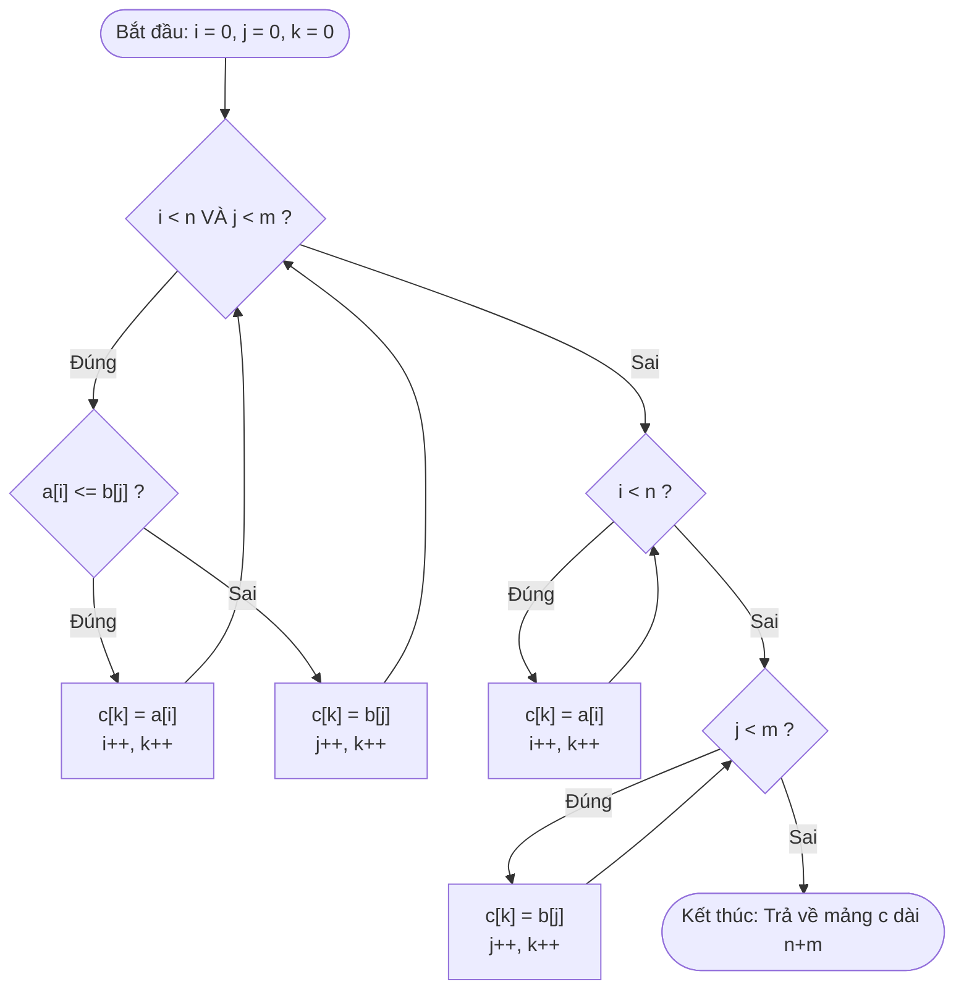

<div align="center">

# 🚀 ĐỒ ÁN HỌC PHẦN: CẤU TRÚC DỮ LIỆU VÀ GIẢI THUẬT (INT13185)
### HỌC VIỆN CÔNG NGHỆ BƯU CHÍNH VIỄN THÔNG — CƠ SỞ TP. HỒ CHÍ MINH

[](src/DeTai.cpp)
[](Danh_sach_va_de_giao/)
[-success.svg?style=for-the-badge)](scripts/trace_and_scales.cpp)
[-orange.svg?style=for-the-badge)](src/DeTai.h)
[](test/runtests.cpp)

<br/>

## 🌐 TRẢI NGHIỆM DEMO TRỰC TUYẾN
### 👉 **[BẤM VÀO ĐÂY ĐỂ MỞ WEB MÔ PHỎNG THUẬT TOÁN (LIVE DEMO)](https://ngochoan026.github.io/DT023/)** 👈

*Giao diện mô phỏng trực quan kỹ thuật hai con trỏ (Two-Pointers), tự động lần vết từng bước và đếm số phép so sánh trực tiếp trên trình duyệt web.*

</div>

---

## 👨‍💻 THÔNG TIN SINH VIÊN & ĐỀ TÀI

| Mục thông tin | Chi tiết thực hiện |
| :--- | :--- |
| **Họ và tên sinh viên** | **Nguyễn Ngọc Hoan** |
| **Mã số sinh viên (MSSV)** | **N24DCDT026** |
| **Lớp học phần** | **D24CQDT01-N** |
| **Học phần & Nhóm** | Cấu trúc dữ liệu và giải thuật (INT13185 — Nhóm 03) |
| **Giảng viên hướng dẫn** | **ThS. Hồ Nhựt Minh** |
| **Mã đề tài** | **DT023** |
| **Tên đề tài** | **Trộn hai mảng đã sắp trong thời gian tuyến tính** *(Merge Two Sorted Arrays in Linear Time)* |
| **Căn cứ giáo trình** | Giáo trình CTDL & GT (INT1306): Chương 2, Mục 2.8 Bài 23; liên hệ tiêu chí sắp xếp Mục 2.1 |

---

## 📖 NỘI DUNG VÀ NGUYÊN LÝ THUẬT TOÁN

### 1. Mục tiêu bài toán
Tạo một mảng tăng không giảm dài $n + m$ từ hai mảng đã sắp tăng $a$ (dài $n$) và $b$ (dài $m$) trong thời gian tuyến tính $\Theta(n + m)$ và bộ nhớ phụ $O(1)$ ngoài mảng kết quả, **tuyệt đối không dùng hàm `sort` lại toàn bộ**.

### 2. Kỹ thuật hai con trỏ (Two-Pointers)
1. Dùng hai chỉ số $i$ và $j$ bắt đầu từ đầu hai mảng $a$ và $b$.
2. So sánh $a[i]$ và $b[j]$: chọn phần tử nhỏ hơn hoặc bằng đưa vào $c$, tăng chỉ số tương ứng.
3. Khi một mảng đã duyệt hết, sao chép tuần tự toàn bộ phần đuôi còn lại của mảng kia vào $c$.
4. Giữ nguyên số lần xuất hiện của mọi giá trị trùng lặp.
5. **Mở rộng**: Cài đặt thêm hàm `tron_hai_mang_giam` trộn hai dãy giảm dần ($a[i] \ge b[j]$).

### 3. Sơ đồ xử lý thuật toán


---

## 📂 CẤU TRÚC THƯ MỤC DỰ ÁN

```text
DT023/
├── index.html                 # 🌐 Web Demo trực tuyến (chạy trên GitHub Pages)
├── src/
│   ├── DeTai.h                # Khai báo hàm, cấu trúc dữ liệu và namespace DeTai
│   ├── DeTai.cpp              # Cài đặt thuật toán C++ chính
│   └── DeTai.jl               # Bản cài đặt tham chiếu Julia
├── test/
│   ├── runtests.cpp           # Bộ kiểm thử 13 ca toàn diện C++
│   ├── runtests.py            # Runner kiểm thử Python
│   └── runtests.jl            # Bộ test Julia
├── scripts/
│   ├── trace_and_scales.cpp   # Kịch bản khảo sát 3 quy mô (Q1, Q2, Q3) C++
│   └── trace_and_scales.jl    # Khảo sát quy mô Julia
├── docs/
│   └── anh_ket_qua/           # Thư mục lưu trữ 11 ảnh minh chứng thực thi (A01 -> A11)
├── demo.cpp                   # Chương trình thực thi C++ chạy riêng từng ví dụ
├── demo.py                    # Chương trình demo Python
├── build.bat                  # Script biên dịch tự động nhanh bằng g++
├── chay_vd1.bat               # 1-click chạy riêng Ví dụ 1
├── chay_vd2.bat               # 1-click chạy riêng Ví dụ 2
├── chay_test.bat              # 1-click chạy bộ kiểm thử
└── README.md                  # Tài liệu giới thiệu dự án
```

---

## ⚡ HƯỚNG DẪN BIÊN DỊCH VÀ CHẠY DÒNG LỆNH

### 1. Biên dịch toàn bộ (chỉ 1 lần)
```cmd
g++ -std=c++17 -O2 demo.cpp src/DeTai.cpp -o demo.exe
g++ -std=c++17 -O2 test/runtests.cpp src/DeTai.cpp -o test/runtests.exe
g++ -std=c++17 -O2 scripts/trace_and_scales.cpp src/DeTai.cpp -o scripts/trace_and_scales.exe
```
*(Hoặc nhấp đúp tệp `build.bat` trên Windows).*

### 2. Các lệnh chạy riêng từng ví dụ
| Chức năng thực thi | Lệnh thực thi C++ | Lệnh thực thi Python |
| :--- | :--- | :--- |
| **Chạy riêng Ví dụ 1 (VD01)** | `./demo.exe 1` | `python demo.py 1` |
| **Chạy riêng Ví dụ 2 (VD02)** | `./demo.exe 2` | `python demo.py 2` |
| **Chế độ nhập bàn phím** | `./demo.exe --keyboard` | `python demo.py --keyboard` |
| **Chạy toàn bộ bộ test (13 ca)**| `./test/runtests.exe` | `python test/runtests.py` |
| **Khảo sát 3 quy mô (Q1, Q2, Q3)**| `./scripts/trace_and_scales.exe`| `python scripts/trace_and_scales.py`|

---

## 🧪 KẾT QUẢ KIỂM THỬ ĐỘC LẬP (13/13 PASS 100%)

```text
================================================================================
BẮT ĐẦU CHẠY BỘ KIỂM THỬ ĐỘC LẬP (>= 12 CA) - ĐỀ TÀI DT023 (C++)
Sinh viên: Nguyễn Ngọc Hoan - MSSV: N24DCDT026
================================================================================
  [PASS] VD01: Ví dụ 1 phiếu (trùng khóa 3, 5 so sánh)
  [PASS] VD02: Ví dụ 2 phiếu (mảng a rỗng, chép đuôi b, 0 so sánh)
  [PASS] TK01: Xen kẽ hoàn toàn (so sánh cực đại n+m-1 = 7)
  [PASS] TK02: b nhỏ hơn hẳn a (chép đuôi toàn bộ a, m = 3 so sánh)
  [PASS] BIEN01: Cả hai mảng đều rỗng (0 so sánh)
  [PASS] BIEN02: Bảo toàn số lượng 3 số 1 trùng khóa
  [PASS] BIEN03: Mảng chứa cả số âm và số 0
  [PASS] BIEN04: Một mảng 1 phần tử chèn vào giữa mảng kia
  [PASS] KT09: Ca phiếu 5 ([5,6] và [1,2], so sánh cực tiểu min(n,m)=2)
  [PASS] LOI01: Bắt ngoại lệ khi mảng a chưa sắp tăng
  [PASS] LOI02: Bắt ngoại lệ khi kích thước vượt quá 5000
  [PASS] KT12: Bất biến bảo toàn tần suất các phần tử trùng và tính tăng dần
  [PASS] MO_RONG: Trộn hai mảng giảm dần thành mảng giảm dần
================================================================================
TỔNG KẾT KIỂM THỬ: ĐẠT 13 / 13 PHÉP KIỂM (PASS 100%)!
================================================================================
```

---

<div align="center">
  <sub>Học viện Công nghệ Bưu chính Viễn thông · Đồ án Cấu trúc dữ liệu và giải thuật 2026</sub>
</div>
